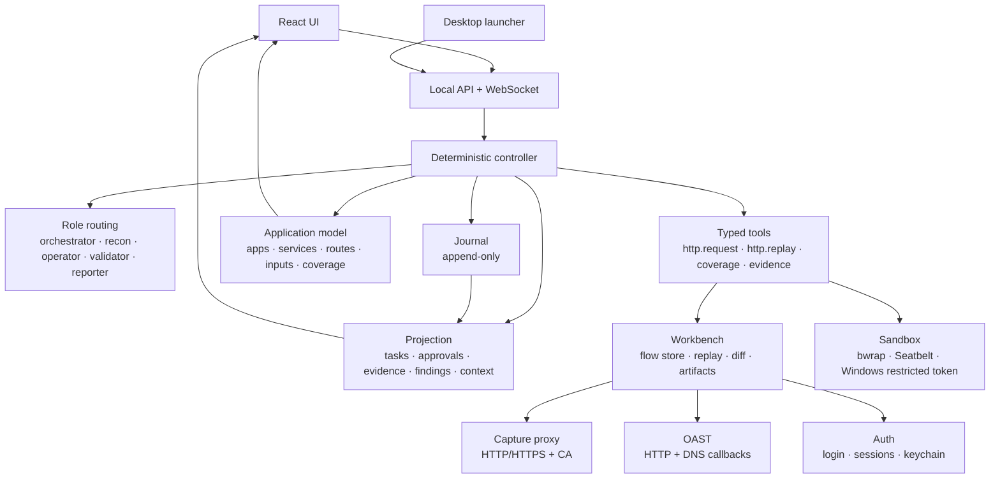

<div align="center">

#  ChainsawRecon

**A local-first, journal-backed pentesting harness for authorized security research.**

Turn recon and manual testing into durable, reproducible evidence — not a pile of scanner output,
chat logs, or lost requests.

[](https://www.python.org/)
[](#)
[](#execution-and-sandbox)
[](#project-status)
[](LICENSE)

</div>

---

ChainsawRecon is not a chatbot with a shell. It is a harness with an append-only journal, a
project-wide application model, typed tasks, scoped execution, and an evidence lifecycle.

Use it to:

- select an engagement folder and keep all sessions inside it
- capture HTTP/HTTPS traffic through a local proxy and CA
- replay, mutate, compare, and promote requests to evidence
- map applications, services, routes, inputs, identities, and coverage
- log in with credentials or a real browser session and run authorization tests
- let a model operate a small, validated tool surface under scope and approval gates
- produce findings, hypotheses, and report drafts with exact evidence references

> **Authorized testing only.** Use ChainsawRecon only against systems you own or have explicit
> written permission to test. You are responsible for staying inside the program scope and rules of
> engagement.

---

## Project status

| Area | State |
|---|---|
| Journal-first sessions | ✅ append-only, hash-chained journal + rebuildable SQLite projection |
| Application model | ✅ apps, services, routes, inputs, identities, technologies, findings, edges, notes |
| Coverage ledger | ✅ tested/untested, negative outcomes, gaps |
| Sitemap | ✅ hierarchical graph + coverage ribbon |
| HTTP workbench | ✅ history, replay, mutation, diff, evidence, HAR/Burp import, HAR/JSONL export |
| Capture proxy | ✅ HTTP + HTTPS MITM with local CA, scope enforcement, WebSocket relay |
| Auth profiles | ✅ detection, HTTP form login, Playwright browser handover, keychain sessions, renewal |
| Findings | ✅ evidence-bound lifecycle, evidence roles/versioning, gated transitions |
| Hypotheses | ✅ security questions, transitions, lineage |
| Reports | ✅ Markdown/HTML/JSON drafts, validated-only by default, coverage gaps, evidence appendix |
| Project archives | ✅ `.chainsaw` zip with SQLite backups, SHA-256 manifest, download |
| Tool agent | ✅ scoped tools, `http.request`, `http.replay`, coverage, evidence, task completion |
| OAST | ✅ HTTP + DNS callbacks, tokenized, redacted, promotable to evidence |
| Multi-model roles | ✅ per-role provider/model routing |
| Native sandbox | 🟢 bwrap, Seatbelt, Windows restricted token + Low integrity + Job Object | read/network policy |
| Desktop launcher | 🟡 pywebview/browser fallback; no installer required |
| WebSockets | 🟢 upgraded and relayed; handshake captured, frames not parsed |
| HTTP/2 | ⏳ planned |

---

## Quick start

### Requirements

- Python 3.10+
- `uv`
- Node.js 18+ for the UI build
- Git

### One-time setup

```bash
git clone https://github.com/R1zoro/ChainsawRecon.git
cd ChainsawRecon

uv sync
npm --prefix ui install
npm --prefix ui run build
```

### Start the app

```bash
uv run chainsaw-recon
```

Or double-click:

- Windows: `ChainsawRecon.bat`
- macOS: `ChainsawRecon.command`
- Linux: `ChainsawRecon.sh`

It starts the local API, serves the built UI, and opens a native window when `pywebview` is
installed. Otherwise it opens the default browser. If the default port (8765) is already busy,
the launcher picks a free port and prints the URL.

Optional native window:

```bash
uv sync --extra desktop
```

### API only

```bash
uv run chainsaw-serve
# http://127.0.0.1:8765/api/v1/health
```

### Optional: browser-backed model provider

Use a logged-in ChatGPT or DeepSeek web session as a role model:

```bash
uv sync --extra webui
uv run playwright install chromium
```

The provider opens a real Chromium profile for manual login. It does not store passwords, solve
CAPTCHAs, or bypass bot controls.

### Optional: OS keychain

```bash
uv sync --extra secrets
```

Session and workbench keys prefer the OS keychain and fall back to local encrypted files.

---

## The model

Engagements are ordinary folders. Everything that belongs to an engagement stays inside it.

```text
<engagement>/
  .chainsaw/
    project.json
    scope/
    knowledge.db              # application model + coverage
    workbench.db              # captured/imported/replayed HTTP flows
    artifacts/                # redacted evidence artifacts
    sessions/
      <session-id>/
        session.json
        journal.jsonl         # append-only source of truth
        state.db              # rebuildable projection
        artifacts/
        workspace/
```

Machine-wide state lives separately:

```text
~/.chainsawrecon/
  providers.json
  ca/                         # local proxy CA (private key + certificate)
  auth/                       # encrypted auth sessions
  secrets/                    # workbench encryption key / keychain fallback
  tools/                      # tool packs
  projects.json               # engagement path index
```

This means:

- moving or copying an engagement folder moves its sessions, journals, evidence, and sitemap
- multiple sessions can run under one engagement
- deleting a session does not destroy the engagement
- auth sessions and CA keys are machine-local, not project data

---

## Feature tour

### Journal and projection

Every session is an append-only journal. The SQLite `state.db` is a rebuildable projection for
tasks, approvals, observations, evidence, findings, hypotheses, and context packets. The journal is
the source of truth; the projection is a cache.

```bash
uv run chainsaw-serve
```

The API exposes journal pages, replay from `afterSeq`, and WebSocket streaming.

### Application model and coverage

The application model is not a URL queue. It stores:

```text
application → service → route → input
identity → route
technology, flow, entity, finding
```

Coverage is recorded per entity and risk area:

```text
reported · no_issue_found · ruled_out · not_applicable · needs_follow_up
```

The sitemap view and coverage ribbon answer the questions that matter:

- what exists?
- what was tested?
- what is untested?
- what has a finding?
- where are the coverage gaps?

### HTTP workbench

The workbench is native; Burp is optional.

- capture HTTP and HTTPS through a local proxy
- inspect requests/responses with redacted headers
- replay with query/path/header/cookie/form/JSON patches
- destructive methods require justification
- compare baseline and candidate responses
- save a request/response pair as hashed evidence
- import HAR or Burp XML
- export HAR or JSONL

The proxy checks scope before forwarding. Out-of-scope requests are blocked and recorded.

### Auth profiles

Auth is a testing dimension, not an afterthought.

- detect auth mechanisms and bot protection from captured traffic
- parse login forms, CSRF fields, and login candidates
- HTTP form login with positive and negative verification
- real Chromium handover for JS-heavy, OAuth/SSO, MFA, or bot-protected targets
- encrypted sessions, OS keychain, expiry detection, renewal
- attach an active session to replay or tool runs with `authProfileId`
- keep multiple identities for authorization testing; side-by-side A/B comparison is a planned UI flow

CAPTCHA/2FA remains operator-in-the-loop. The harness does not automate CAPTCHA solving or evade
account controls.

### Findings, hypotheses, reports

A 200 response is not a finding. Findings carry:

- title, severity, state, asset
- evidence bindings with roles (`baseline`, `proof`, `control`, `verification`, `supporting`)
- evidence version
- reproduction and impact where recorded
- validation events and reasons

Hypotheses capture the security question and required evidence. Report drafts are generated from
the session projection:

- validated findings by default
- optional candidate findings with a visible warning
- evidence appendix with hashes and roles
- coverage outcomes and gaps
- explicit limitations

Markdown, HTML, and JSON export are supported. PDF export is still planned.

### Tool agent

Models can operate a small typed tool surface:

- `http.request` — send a new in-scope request
- `http.replay` — replay a captured request with a patch
- `workbench.search` — search redacted history
- `appmodel.query` — query entities and coverage
- `coverage.record` — record positive or negative coverage
- `evidence.record` — pin evidence
- `task.complete` — finish the task
- optional `shell.exec` — only when explicitly enabled and a sandbox is available

Every HTTP action is scope-checked and paced. Every evidence artifact is hashed. No model writes the
journal directly.

### OAST

Blind SSRF/XSS and callback checks need a unique target URL:

- HTTP callback tokens
- UDP DNS callback tokens
- redacted headers and bounded bodies
- project-scoped event store
- promote a callback to hashed evidence

No DNS recursion, DNSSEC, or CNAME support yet.

### Multi-model roles

Use one model or many. Roles are contracts:

| Role | Job |
|---|---|
| Orchestrator | choose one next task, or finish |
| Recon | triage surfaces and propose probes |
| Operator | execute one leased task |
| Validator | independently review evidence |
| Reporter | turn validated findings into a report |

Per-role assignments can use different providers/models. Single-provider operation is supported.

### Execution and sandbox

Native-first:

- **Linux:** `bwrap` — read-only root, writable workspace, private namespaces.
- **macOS:** `sandbox-exec` — Seatbelt profile, workspace/TMP writes only.
- **Windows:** Safer `Basic User` restricted token + Low integrity + Job Object + Low-integrity
  workspace ACL. Admin SIDs and privileges are stripped, and writes outside the workspace are
  denied. Reads and network are still allowed; blocking those needs an AppContainer or firewall
  policy, so a request to deny network fails closed.
- **Docker/Podman:** optional, not required.

Shell execution is opt-in. On platforms where reads/network are not confined, the UI must show that
boundary explicitly rather than implying full isolation.

---

## Architecture



### The rules

1. **Models propose, never commit.** The controller validates and writes.
2. **Every action has a receipt.** Inputs, output hash, artifact, scope decision, approval, timestamps.
3. **Every observation is grounded.** It points to a concrete artifact.
4. **Every finding is reproducible.** Evidence bindings, control, and validation state.

---

## Current limitations

- Windows sandbox strips admin privileges with a Safer restricted token and write-confines via Low
  integrity; reads and network are not confined, and AppContainer/firewall policy is still pending.
- HTTP/2 is not implemented. WebSocket upgrades are relayed and the handshake is captured, but
  frames are not parsed or stored.
- OAST supports HTTP and A-record DNS only.
- Request/response bodies and URL query parameters are not encrypted at rest; sensitive headers are.
- Web UI model automation is browser-driven and selector-fragile by nature.
- No automatic CAPTCHA solving or bot evasion.
- Report export supports Markdown, HTML, and JSON; PDF export is not implemented.
- The desktop launcher is a local wrapper; there is no signed installer.
- There is no public benchmark or efficacy claim. Manual validation is required.

---

## Repository layout

```text
chainsaw/                   # v2 core
  api/                      # FastAPI app, registry, request models
  appmodel.py               # revisioned application model, coverage, sitemap
  archive.py               # project archive snapshots
  auth.py                   # auth detection, HTTP/browser login, sessions
  ca.py                     # local root CA + leaf certificates
  context.py                # role visibility, token budgets, compression
  controller.py             # supervisor tick + single-action executor
  governor.py               # per-host request pacing/backoff
  journal.py                # append-only hash-chained journal
  launcher.py               # local desktop launcher
  oast.py                   # HTTP + DNS out-of-band callbacks
  projection.py             # rebuildable SQLite projection
  providers.py              # OpenAI-compatible provider client
  proxy.py                  # HTTP/HTTPS capture proxy
  reports.py                # session report drafts
  role_runtime.py           # per-role provider/model resolution
  roles.py                  # role contracts and routing
  runner.py                 # supervisor/operator loop
  runtime.py                # task/evidence/finding/context writers
  sandbox.py                # native execution boundary
  secrets.py                # header sealing + keychain fallback
  tools.py                  # typed tool registry + tool agent
  webui.py                  # browser-backed ChatGPT/DeepSeek provider
  workbench.py              # flow store, replay, compare, evidence, import/export
  workspace.py              # engagement/session filesystem layout

ui/                         # React + Vite UI
  src/features/
    ready-state/            # home, recent engagements
    engagement-wizard/      # scope and setup flow
    sessions/               # journal, tasks, approvals, tool agent
    app-model/              # graph, sitemap, table, coverage
    workbench/              # capture, history, repeater, compare, OAST
    findings/               # findings, evidence tray, transition gates
    hypotheses/             # hypothesis lifecycle
    reports/                # report generation
    auth/                   # auth profiles and login
    models/                 # providers and models
  src/test/                 # Vitest suites

sandbox/                    # optional container definition
bounty_agent/               # legacy CLI package
engagements/                # local engagement workspaces (git-ignored)
ChainsawRecon.bat           # Windows launcher
ChainsawRecon.command       # macOS launcher
ChainsawRecon.sh            # Linux launcher
```

Internal research, cloned references, planning notes, and some tests are local-only and intentionally
ignored by git.

---

## Legacy CLI

The original `bounty_agent` CLI remains in the tree for reference. It is not the v2 runtime.

```bash
python -m bounty_agent.cli \
  --engagement engagements/my-engagement \
  --mode auto \
  --provider ollama \
  --model ollama/qwen3:8b \
  --llm-base-url http://localhost:11434/v1 \
  --runner local \
  --execute \
  --max-steps 200
```

The v2 path is `chainsaw/` plus the local API/UI.

---

## Safety

1. Scope is checked at the controller, workbench, replay, auth, and proxy layers.
2. Out-of-scope proxy requests are blocked and recorded.
3. HTTP actions are paced per host with backoff on 429/503.
4. Destructive methods require justification.
5. Findings require recorded evidence; evidence has roles and a version.
6. Secrets are redacted in public reads and sealed at rest where possible.
7. CAPTCHA/2FA is operator-in-the-loop.
8. No scanner output is treated as proof.

---

## Contributing

- Open an issue with a concrete reproduction or design proposal.
- Keep changes scoped and add tests for behavior changes.
- Never commit secrets, engagement data, captured traffic, or generated artifacts.
- For security issues, do not open a public issue; contact the maintainer privately.

---

## License

MIT. See [LICENSE](LICENSE).

<div align="center">

[Report an issue](https://github.com/R1zoro/ChainsawRecon/issues)

</div>
