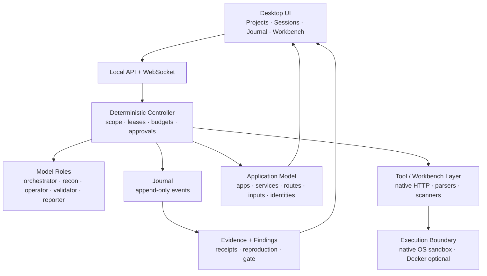

<div align="center">

# ⛓️🪚 ChainsawRecon

**A stateful, evidence-first pentesting harness for authorized security research.**

[](https://www.python.org/)
[](#)
[](#execution-and-sandbox)
[](#project-status)
[](https://github.com/R1zoro/ChainsawRecon)

**If ChainsawRecon saves you time, please consider leaving a star — it helps other researchers find it.**

</div>

---

ChainsawRecon is a desktop-style security workbench and autonomous execution engine. It is built
for one job: turn authorized recon and testing into **durable, reproducible evidence** instead of a
pile of scanner output and chat logs.

It is not a chatbot with a shell. It is a harness with a journal, an application model, typed
tasks, scoped execution, and an evidence lifecycle.

> **Authorized testing only.** Use ChainsawRecon only against systems you own or have explicit
> written permission to test. You are responsible for staying inside the program scope and rules.

---

## Why ChainsawRecon

- **Journal first.** Every session is an append-only event log. Resume, audit, replay, and UI
  streaming come from the same source of truth.
- **Application model, not a URL queue.** Applications, services, routes, inputs, identities,
  entities, technologies, and flows are modeled together with confidence and freshness.
- **Deterministic control.** Models propose; deterministic code validates scope, leases tasks,
  records receipts, enforces budgets, and advances state.
- **Evidence-backed findings.** A 200 response is not a finding. Findings require a security
  question, a hypothesis, exact request/response artifacts, reproduction, and an independent gate.
- **Multi-model roles, one or many providers.** Use one model for everything, or assign different
  providers to the orchestrator, recon analyst, tool operator, validator, and reporter.
- **Native execution.** OS-level confinement on Windows, Linux, and macOS. Docker is optional, not
  a requirement.
- **Built-in HTTP workbench.** Capture, search, replay, mutate, diff, and promote traffic to
  evidence without requiring Burp. Burp MCP remains an optional integration.
- **Auth profiles as a first-class dimension.** Manual browser handover, saved sessions, credentials,
  SSO/OAuth, and multiple identities with side-by-side authorization testing.

---

## Project status

**v2 is under active development.** The repository currently contains the legacy agent CLI and
domain modules while the journal/application-model runtime, native sandbox, workbench, and desktop
UI are being rebuilt. The architecture below is the target; features marked **planned** are not in
the current tree yet.

| Area | Current | Target |
|---|---|---|
| CLI agent loop | ✅ legacy | replaced by deterministic controller |
| Scope guard / sandboxed tools | ✅ legacy | native OS sandbox + optional container |
| Journal / application model | 🟡 in progress | append-only journal + revisioned graph |
| Multi-model role routing | 🟡 in progress | per-role provider/model selection |
| Native HTTP workbench | ⏳ planned | capture/replay/diff/evidence |
| Auth profiles / embedded auth browser | ⏳ planned | handover, sessions, multi-identity |
| Desktop UI (Tauri) | ⏳ planned | project/session workspace |

### v2 core already in the tree

- `chainsaw/roles.py` — arbitrary per-role model routing, single-provider `Solo`, fallbacks,
  capability validation.
- `chainsaw/context.py` — role visibility, token budgets, deterministic compression ladder,
  overflow errors.
- `chainsaw/journal.py` — append-only session journal with hash chain, verification, redaction.
- `chainsaw/projection.py` — rebuildable SQLite projection for tasks, approvals, evidence, findings,
  and context.
- `chainsaw/runtime.py` — deterministic task lifecycle, approvals, observations, evidence, findings,
  and context events (the write seam for the controller).
- `chainsaw/appmodel.py` — project-wide revisioned application model (apps, services, routes,
  inputs, identities, technologies, findings, edges, notes).
- `chainsaw/workspace.py` — global home, project layout, session layout, session creation.
- `chainsaw/toolpacks.py` — pinned manifests, checksum-verified install plans, tool-pack status.
- `chainsaw/api/` — local FastAPI/WebSocket API for projects, sessions, journal, providers, and
  runtime placeholders.
- `ui/` — Ready State UI; M0 review is in progress.

---

## Architecture at a glance



### The four rules

1. **Models propose, never commit.** A model can choose a task or return a structured result; the
   controller validates it and writes the journal event.
2. **Every action has a receipt.** Command, environment, output hash, artifact, scope decision,
   approval, and timestamps.
3. **Every observation is grounded.** It must cite an exact slice of a receipt. Paraphrases are not
   evidence.
4. **Every finding is reproducible.** Baseline, candidate, control, and a second review before it can
   be called validated.

---

## Model roles

Use one provider or many. Roles are contracts, not separate agents.

| Role | Responsibility | Typical model |
|---|---|---|
| **Orchestrator** | Choose the next task, propose one task, or finish. | Strong reasoning / high context |
| **Recon analyst** | Classify pre-parsed surfaces, triage JS/tool output, choose one probe from a menu. | Small local model / cheap API |
| **Tool operator** | Execute exactly one leased task using allowed tools. | Local 7B / cheap API |
| **Validator** | Independently review evidence and the 7-Question Gate. | Different provider when possible |
| **Reporter** | Turn validated findings into a report. | Strong writing model |

If you configure only one provider, every role uses it. There is no “minimum number of models”
requirement. Per-role routing, fallback chains, budgets, and capability checks live in the UI and
config.

---

## Execution and sandbox

The v2 execution boundary is **native-first**:

- **Linux:** `bwrap` + Landlock (read-only host root, private PID namespace, workspace-write).
- **macOS:** Seatbelt (`sandbox-exec`).
- **Windows:** restricted token + ACL write grants + Low integrity + Job Objects.
- **Docker/Podman:** optional for untrusted tools, reproducibility, or CI.

The legacy tree currently uses a local/Docker runner; the native sandbox is part of the v2 rebuild.
The sandbox confines file effects, not network or reads. Network access is governed by the scope
guard and an egress proxy; destructive or high-volume actions require approval. If no sandbox
backend is available, confined execution fails closed rather than running unconfined.

Tool binaries are managed as **tool packs** in a global cache, not baked into one giant image. The
harness owns the catalog, pinned version, checksum, install/update/health, and parser. The default
Lite installer downloads the recommended `web-core` pack on first run; an Offline installer bundles
it. This keeps the desktop build small while giving you the tools you need for real recon.

---

## Quick start (current legacy CLI)

> The commands below run the current tree. The v2 desktop UI and journal runtime are being built.

**Requirements:** Python 3.12+, Git, and an OpenAI-compatible model endpoint (Ollama, vLLM, LM
Studio, or a hosted API).

```bash
git clone https://github.com/R1zoro/ChainsawRecon.git
cd ChainsawRecon
uv sync
cp .env.example .env
```

Create an engagement from the template:

```powershell
Copy-Item -Recurse engagements\_template engagements\my-engagement
```

Edit `engagements/my-engagement/program/`:

- `scope.json` — domains, URLs, exclusions, rate limits
- `in-scope.txt` / `out-of-scope.txt`
- `rules.md` — program rules
- `prompt.md` — operator goals
- `auth.json` — optional auth profiles / login spec
- `priority-targets.txt` — optional deep-test list

Run the legacy CLI:

```bash
python -m bounty_agent.cli \
  --engagement engagements/my-engagement \
  --mode auto \
  --provider ollama \
  --model ollama/qwen3:8b \
  --llm-base-url http://localhost:11434/v1 \
  --runner local \
  --execute \
  --max-steps 200
```

Use `--runner docker` only if you want the optional container boundary:

```bash
docker build --pull -f sandbox/Dockerfile.sandbox -t chainsaw-sandbox:latest .
python -m bounty_agent.cli ... --runner docker --docker-image chainsaw-sandbox:latest --execute
```

Inspect the output under `engagements/my-engagement/agent/`.

### v2 API preview

The new core/API can be started independently:

```bash
uv run chainsaw-serve
# http://127.0.0.1:8765/api/v1/health
```

The API currently provides project/session creation, the append-only journal, run controls, provider
registration, a rebuildable projection for tasks/approvals/evidence/findings/context, and a
project-wide application model (apps, services, routes, inputs, identities, technologies, edges).
The runtime that produces those events is the next milestone. It is local-only and intended for the
desktop UI.

---

## Project and session layout

ChainsawRecon v2 uses a project/session model:

```text
~/.chainsawrecon/                 # global: providers, credentials, tool packs, index
  config.json
  credentials.json
  providers/
  tools/
  index.db

<your-project>/                   # any folder you choose
  .chainsaw/
    project.json
    scope/
    knowledge.db                  # application model + validated findings
    catalogs/
    reports/
    sessions/
      <session-id>/
        session.json
        journal.jsonl             # append-only source of truth
        state.db                  # rebuildable projection
        artifacts/
        workspace/
```

- **Global:** identity, provider config, browser profiles, tool packs, UI settings.
- **Project/engagement:** scope, rules, application model, sitemap, validated findings, reports.
- **Session:** journal, task board, budgets, raw tool outputs, candidate evidence.

---

## Auth profiles

The v2 auth model treats authentication as part of execution, not a prompt afterthought:

- **No auth**, **credentials reference**, **saved session/cookie**, **manual browser handover**,
  **recorded login**, **OAuth/SSO**, **API token**, or **custom headers**.
- An **embedded auth browser** lets the operator complete login, CAPTCHA, and 2FA in a real browser
  window; the harness captures the resulting session state and reuses it for the mapped domains.
- Multiple identities can be attached to the same application for side-by-side authorization
  testing.
- Sessions are scoped to their cookie domains, verified, kept alive, and renewed. Secrets never
  enter prompts, journals, or reports.
- Each profile chooses a simple persistence mode: **Don’t save** (ephemeral), **Save session only**
  (default), or **Save credentials**. The account list is ordinary project metadata; passwords,
  cookies, and tokens are protected by the OS keychain, with an encrypted-file fallback.
- CAPTCHA/2FA is operator-in-the-loop. The harness does not automate CAPTCHA solving or evade
  account controls.

---

## Safety

1. Scope is checked at the controller, tool, and proxy layers.
2. Commands run confined; Docker is optional.
3. Every action has a budget, rate limit, and audit event.
4. Risky or state-changing actions require approval.
5. Findings require exact evidence and independent validation.
6. Secrets are redacted before they reach the journal, UI, or report.
7. The harness never treats scanner output as proof.

---

## Repository layout

```text
bounty_agent/        # legacy Python package (agent loop, tools, domain adapters)
chainsaw/            # v2 core: role routing, context budgets, journal, tool packs
ui/                  # desktop UI (React + Vite; Tauri shell planned)
sandbox/             # optional container definition
engagements/         # template + local engagement workspaces (git-ignored)
pyproject.toml       # Python project metadata
uv.lock              # locked dependencies
```

Internal research, cloned references, planning notes, and tests are kept local and are not part of
the public repository.

---

## Contributing

- Open an issue with a clear reproduction or design proposal.
- Keep changes scoped and include tests for behavior changes.
- Never commit secrets, engagement data, or generated run artifacts.
- For security issues, do not open a public issue; contact the maintainer privately.

---

<div align="center">

**If this project is useful to you, a ⭐ helps more researchers find it.**

[Report an issue](https://github.com/R1zoro/ChainsawRecon/issues) ·
[Star the repo](https://github.com/R1zoro/ChainsawRecon)

</div>
